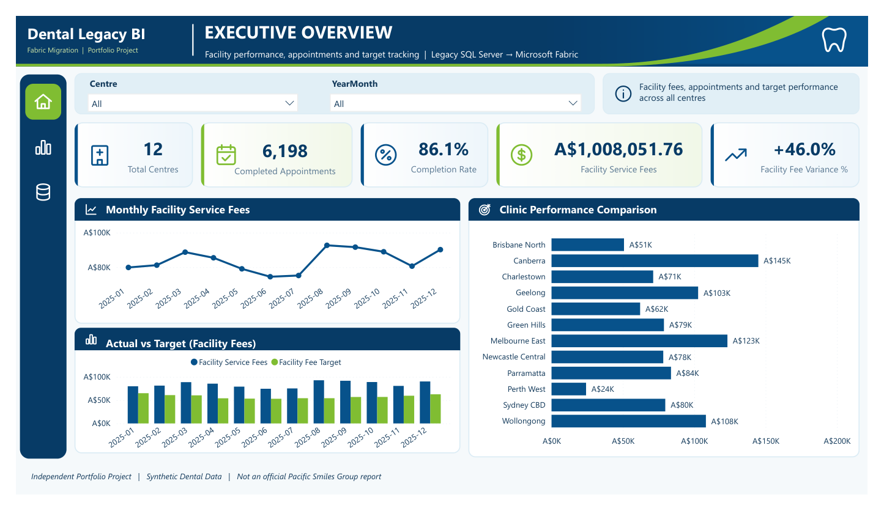

# Dental Legacy BI Migration | SQL Server → Microsoft Fabric → Power BI

**Independent portfolio proof of concept using synthetic dental data.** This project is **not affiliated with or endorsed by Pacific Smiles Group** and does not use real patient or company data. The dashboard's blue-and-green styling was inspired by publicly visible corporate branding, not an official design system.



**Quick review:** [Case Study (PDF)](docs/Case_Study.pdf) · [Dashboard Preview (PDF)](docs/Dashboard_Preview.pdf)

## Project overview

A fictional 12-centre dental network provides the scenario for a legacy business-intelligence migration. The project uses eight designed and generated synthetic source tables, a SQL Server legacy reporting baseline, Microsoft Fabric Lakehouse Delta tables, PySpark transformation and reconciliation, and a three-page Power BI report.

### Architecture

```text
Eight synthetic source CSVs
        ↓
SQL Server legacy tables + reference reporting checks
        ↓
Microsoft Fabric Lakehouse (Files/raw → Delta tables)
        ↓
PySpark transformations + financial/payment reconciliation
        ↓
Curated/validation tables
        ↓
Power BI semantic model + three interactive dashboard pages
```

## Dataset and reported results

| Measure | Result |
| --- | ---: |
| Dental centres | 12 |
| Practitioners | 84 |
| Service catalogue entries | 8 |
| Appointment records | 7,200 |
| Completed appointments / invoices | 6,198 |
| Fully paid invoices / payment records | 5,824 |
| Unpaid invoices | 374 |
| Monthly targets | 144 rows |
| Legacy monthly financial reference | 144 rows |
| Financial reconciliation | **144 passed / 0 failed** |
| Gross invoiced | **A$2,873,354** |
| Payments collected | **A$2,689,156** |
| Outstanding balance | **A$184,198** |
| Facility service fees | **A$1,008,051.76** |

These are reported outcomes of the synthetic proof of concept, not production dental business results. Gross patient fees and facility service fees are different financial measures.

## Repository guide

| Location | What you can review |
| --- | --- |
| [`data/`](data/) | All eight synthetic source CSV tables |
| [`sql/`](sql/) | SQL Server table definitions and legacy financial/data-quality queries |
| [`docs/DATA_DICTIONARY.md`](docs/DATA_DICTIONARY.md) | Data dictionary and business rules |
| [`docs/Case_Study.pdf`](docs/Case_Study.pdf) | Two-page project case study |
| [`docs/Dashboard_Preview.pdf`](docs/Dashboard_Preview.pdf) | Three-page Power BI PDF export |
| [`screenshots/`](screenshots/) | Executive, financial and migration-quality report screenshots |
| [`fabric/evidence/`](fabric/evidence/) | **Exported Fabric notebooks currently uploaded**, plus real Lakehouse screenshots |
| [`fabric/notebooks/`](fabric/notebooks/) | Notebook index and notes; actual `.ipynb` exports are presently under `fabric/evidence/` |
| [`powerbi/`](powerbi/) | Power BI project-sharing notes; native PBIP/PBIX is not published here |

### Available Microsoft Fabric evidence

- [`01_Legacy_Data_Ingestion.ipynb`](fabric/evidence/01_Legacy_Data_Ingestion.ipynb) — exported ingestion notebook.
- [`02_Financial_Reconciliation.ipynb`](fabric/evidence/02_Financial_Reconciliation.ipynb) — exported PySpark financial reconciliation notebook.
- [`LakehouseTables.PNG`](fabric/evidence/LakehouseTables.PNG) — screenshot of the Fabric Lakehouse tables interface.
- [`DentalLegacyLakehouse.PNG`](fabric/evidence/DentalLegacyLakehouse.PNG) — screenshot from the Fabric Lakehouse environment.

**Not yet published:** `03_Payment_Reconciliation.ipynb`, the exported notebook for the payment-level reconciliation process. The payment figures are reported in the case study and dashboard, but that portion's executable Fabric notebook is not yet supplied for independent inspection.

The notebooks and screenshots document the proof-of-concept implementation; screenshots alone do not provide independent end-to-end reproducibility.

## Dashboard pages

1. **Executive Overview:** centre and appointment performance, monthly facility fees, clinic comparisons, and actual versus target.
2. **Financial & Payment Analysis:** billed, collected and outstanding fees, collection rate, monthly trends and payment status.
3. **Migration & Data Quality:** financial reconciliation status, Legacy-versus-Fabric comparison, and validation detail.

## Reproducing the SQL Server baseline

1. Create a database and the `legacy` schema in SQL Server.
2. Run [`sql/01_create_legacy_tables.sql`](sql/01_create_legacy_tables.sql).
3. Import the matching CSVs in [`data/`](data/) while preserving identifiers, dates and decimal precision.
4. Run [`sql/02_legacy_reporting_and_checks.sql`](sql/02_legacy_reporting_and_checks.sql) to validate the legacy financial baseline and integrity checks.
5. Review the [Fabric implementation plan](docs/FABRIC_IMPLEMENTATION_PLAN.md) and the **actually exported** notebooks in [`fabric/evidence/`](fabric/evidence/). The implementation plan is documentation, not evidence of executed code.

Rebuilding the entire Fabric/Power BI environment also requires suitable Fabric resources, Lakehouse configuration and the unpublished Power BI model.

## Visual design and AI assistance

The Power BI report uses a blue-and-green visual style inspired by Pacific Smiles Group's publicly visible branding. Claude Code assisted with the Power BI dashboard layout, visual styling and navigation. The author reviewed model calculations and reconciliation results. No official branding approval or company affiliation is implied.

## Evidence scope and limitations

The published repository includes source CSVs, SQL scripts, two exported Fabric notebooks, Lakehouse screenshots, PDF documentation and report images. The payment reconciliation notebook (`03_Payment_Reconciliation.ipynb`) and native Power BI project have **not** been published. The screenshots provide supporting visual evidence, not independent proof of every execution result.

## Usage

Educational portfolio project using synthetic data. Do not present the dataset, performance figures or system design as official Pacific Smiles Group information.
